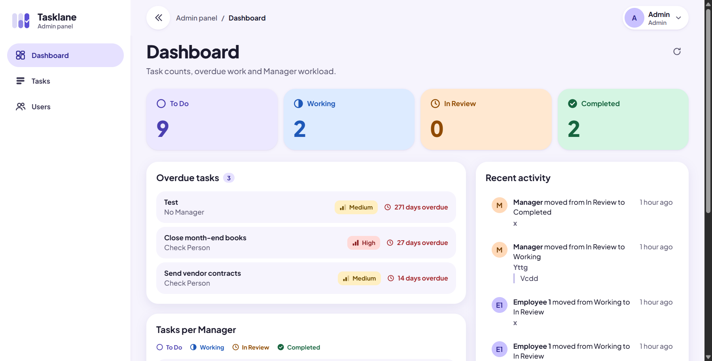
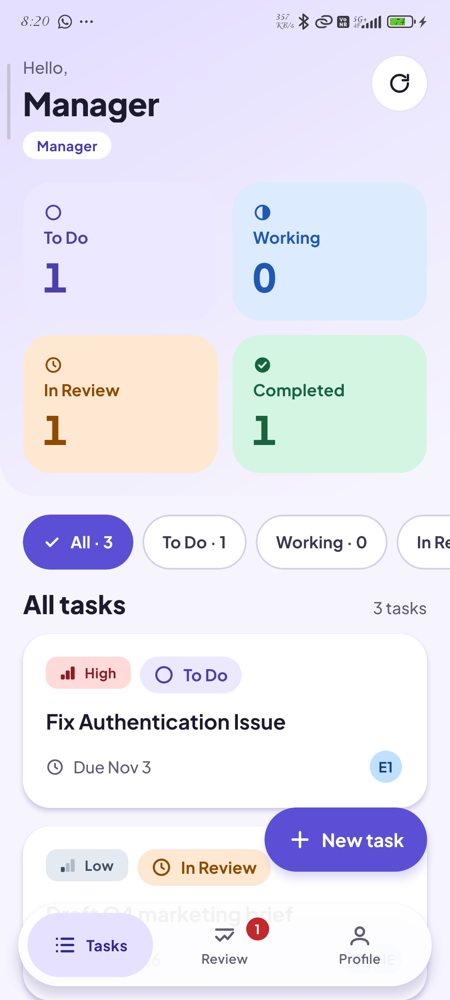
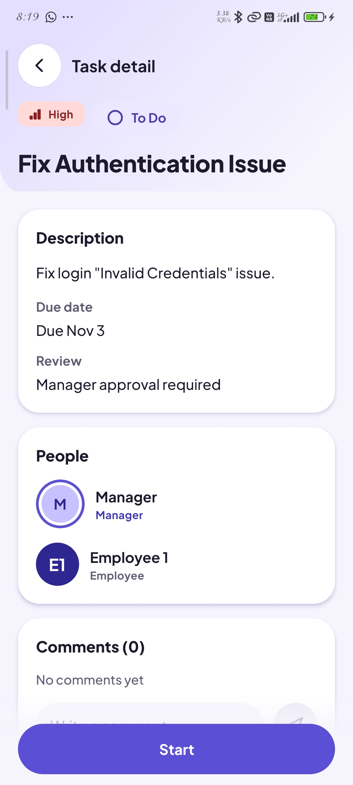
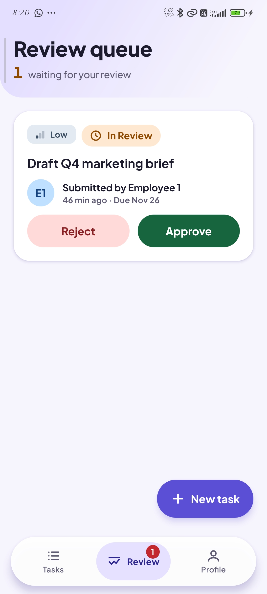
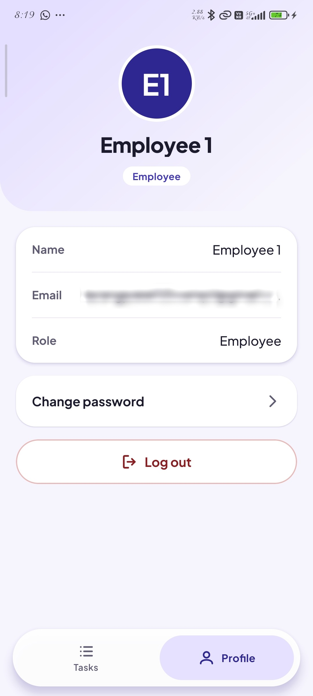
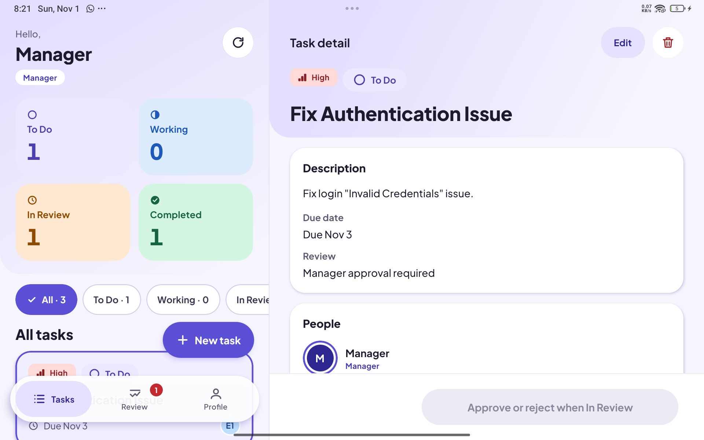

# Tasklane

A full-stack task management app for assigning work and tracking it through review. Admins run the system from a web panel, Managers and Employees work in a mobile app (phone and tablet). Built as a portfolio project; everything runs locally.



|                                           Tasks                                           |                                          Task detail                                           |                                           Review                                           |                                        Profile                                         |
| :---------------------------------------------------------------------------------------: | :--------------------------------------------------------------------------------------------: | :----------------------------------------------------------------------------------------: | :------------------------------------------------------------------------------------: |
|  |  |  |  |



More screenshots: [admin](docs/screenshots/admin/) and [mobile](docs/screenshots/mobile/).

## Roles

| Role     | Client      | What they do                                                                 |
| -------- | ----------- | ---------------------------------------------------------------------------- |
| Admin    | Admin panel | Manages users, sees every task, reviews tasks, reads the dashboard           |
| Manager  | Mobile app  | Creates tasks, picks Employees, approves or rejects work in the review queue |
| Employee | Mobile app  | Starts tasks, submits them for review or completes them, comments            |

A task has one Manager and one or more Employees. Status flow: `TODO` to `WORKING` to `IN_REVIEW` (when review is required) to `COMPLETED`; a rejection sends it back to `WORKING` with a reason. Every change is kept in the task history. Full rules: [docs/project-spec.md](docs/project-spec.md).

## Stack

- API: NestJS, TypeORM, PostgreSQL, JWT access and rotating refresh tokens, Swagger
- Admin panel: React, TypeScript, Vite, TanStack Query, axios
- Mobile app: React Native CLI (Android first), TypeScript, React Navigation, Reanimated, TanStack Query, axios
- Shared types: `packages/shared`
- Yarn classic workspaces monorepo

## Repository layout

```
apps/api         NestJS API (see apps/api/README.md)
apps/admin       Admin panel (see apps/admin/README.md)
apps/mobile      Mobile app (see apps/mobile/README.md)
packages/shared  Shared enums and response types (see packages/shared/README.md)
docs/            Spec, design brief, screenshots
```

## How the pieces fit

- The admin panel and the mobile app are separate clients of the same REST API (`/api/v1`). They never call each other and each has its own axios client. Only the API talks to PostgreSQL.
- `packages/shared` is the one thing the three apps share: enums, the response envelope and the route constants. Run `yarn build:shared` after changing it.
- Auth: the API issues a short-lived access token and a rotating refresh token. Admin signs in on the web panel, Managers and Employees on the phone. Roles are enforced on the server; the clients only hide what a role cannot use.
- Errors always come back as `{ success: false, statusCode, error, message, details?, path, timestamp }`; successes as `{ success: true, data, meta? }`.
- Logs are structured and carry a request id (`X-Request-Id`); auth routes have stricter rate limits. Details in [apps/api/README.md](apps/api/README.md).
- Screens: every admin page and mobile screen is a folder with `index.tsx` and a `subcomponents/` folder for its own parts; shared pieces stay in `components/`. Rules in [docs/project-spec.md](docs/project-spec.md) (section 2). React and React Native code uses arrow functions.
- Not built yet and known limitations (no tests, in-memory rate limits, no proxy setting, Android only): [docs/project-spec.md](docs/project-spec.md) sections 12 and 15.

## Quick start

Needs Node.js, Yarn 1, PostgreSQL, and for the mobile app the Android SDK with a phone or emulator.

1. `yarn install`
2. Copy `.env.example` to `.env` and fill it in (database password, `JWT_ACCESS_SECRET` of at least 32 characters, the seed values).
3. `yarn build:shared`
4. Create the database: `psql -U postgres -c "CREATE DATABASE task_management;"`
5. `yarn workspace @task-app/api migration:run`
6. `yarn workspace @task-app/api seed:admin`
7. `yarn dev:api` (http://localhost:3000), `yarn dev:admin` (http://localhost:5173), and for the phone `yarn dev:mobile` plus `yarn workspace @task-app/mobile android`

Setup details, environment variables and troubleshooting are in each app's README.

## API documentation

With the API running outside production, Swagger UI is at http://localhost:3000/api/docs (use Authorize with an access token from `POST /auth/login`). Routes live under `/api/v1`.

## More docs

- [docs/project-spec.md](docs/project-spec.md): scope, permissions, workflow, API and data model
- [docs/design-brief.md](docs/design-brief.md): visual design direction

Root scripts: `format`, `format:check`, `build:shared`, `dev:api`, `dev:admin`, `dev:mobile`.
