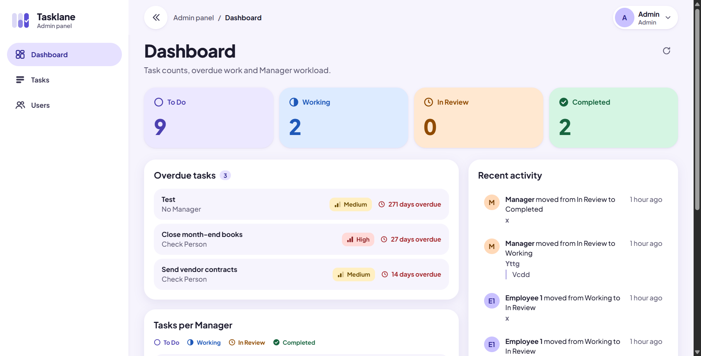

# Admin panel (`@task-app/admin`)

React 19 + TypeScript + Vite. Admin accounts only; Managers and Employees use the mobile app.

More: [users](../../docs/screenshots/admin/users.png), [tasks](../../docs/screenshots/admin/tasks.png), [task detail](../../docs/screenshots/admin/task-detail.png).

## Run

1. From the repo root: `yarn install`, then `yarn build:shared`.
2. Start the API (`yarn dev:api`, see `apps/api/README.md`) with a seeded Admin.
3. `yarn dev:admin` and open http://localhost:5173.

Other scripts: `yarn workspace @task-app/admin typecheck` and `build`.

## Configuration

The dev server proxies `/api` to the API, so the browser sees one origin and no CORS setup is needed in development. To point at another API, copy `.env.example` to `.env` in this folder and set `VITE_API_PROXY_TARGET`. For a deployed panel, set `ADMIN_CORS_ORIGIN` on the API to the panel's origin; the API allows only that origin.

## How it works

- Code style: components, hooks, handlers and helpers are arrow functions (`export const Foo = (): ReactNode => {}`), with explicit return types on exports.
- Constants have one home each; never hardcode them. API paths come from `ENDPOINTS` and `API_BASE_PATH` in `@task-app/shared`, page paths from `PATHS` in `src/app/paths.ts`.
- `src/api/client.api.ts`: axios wrapper for `/api/v1` (all API calls go through it). It unwraps the response envelope, throws `ApiRequestError` (with field `details`), adds the Bearer token, and on a 401 refreshes the session once (single request at a time, because refresh tokens rotate) and retries.
- `src/auth/`: `AuthProvider` and `useAuth` (login, logout, current user), `RequireAuth` route guard, token store. The access token is kept in memory only. The refresh token is kept in `sessionStorage`, so a reload keeps the session but closing the tab ends it. A non-Admin account is signed out again right after login.
- `src/app/router.tsx`: routes. `/login` is public; everything else sits behind `RequireAuth`.
- `src/pages/<Name>Page/`: one folder per page. `index.tsx` is the page (it only orchestrates state and data), `subcomponents/` holds the parts only that page uses (each with its own `.module.css`, nested again when a part has parts of its own), and hooks or helpers shared by several of those parts sit beside `index.tsx`. Anything used by more than one page lives in `src/components/` or `src/hooks/`. See the "Screen and page organization" rules in `docs/project-spec.md`. There is no `features/` folder any more.
- `pages/UsersPage/`: the Users screen (filters, table and cards, create and edit drawer, resend invite, deactivate and reactivate). `pages/DashboardPage/`: the Dashboard (status tiles that link to the filtered task list, overdue list, tasks per Manager as stacked bars, recent activity), all from one `GET /dashboard/summary` call.
- `pages/TasksPage/`: the Tasks screen (search, status, priority, Manager, assignee and due-date filters, table and cards, create and edit drawer with Manager and Employee pickers, detail drawer with comments and status history, Approve, Reject with a required reason, delete). The open task is kept in `?task=<id>` and `?status=` or `?priority=` preset the filters, so other pages can link to a filtered list. The Manager and Employee pickers load up to 100 users per role (the API's page limit).
- Shared UI in `src/components/`: toast (`useToast`), drawer and modal (native `<dialog>`), select field, pagination, skeleton, row menu, badges.

## Layout and styling

- Design source: `docs/design-brief.md` (tokens, brand, responsive rules).
- `src/styles/tokens.css` holds every design token as a CSS variable; components use these only. `global.css` has the reset, focus ring and reduced-motion rules. Components use CSS Modules (`*.module.css`); there is no UI library.
- `src/layout/`: `AppShell` (sidebar, top bar, routed content), `Sidebar`, `TopBar`, `ProfileMenu`. Breakpoints are 640 and 1024: from 1024 the sidebar is fixed and collapsible, below it slides in as a drawer.
- Plus Jakarta Sans is loaded from Google Fonts in `index.html`, so the first load needs internet access.
